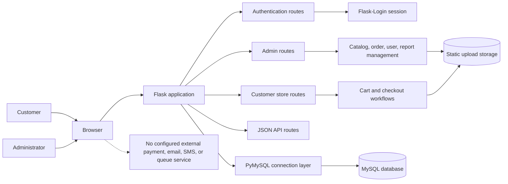

# MJC Gadget Hub

MJC Gadget Hub is a Flask and MySQL e-commerce application for browsing consumer electronics, managing a cart, placing orders, and operating a store through an administrator dashboard.

## Portfolio summary

This project demonstrates a server-rendered commerce workflow with customer and administrator roles. Customers can register, authenticate, browse and search products, manage cart quantities, submit checkout orders, upload online-payment proof, and track order status. Administrators can manage products and categories, review and update orders, manage user access, and view sales reports.

The application is a local-development project. Payment, email, SMS, and other production integrations are not configured; online payment is represented by an uploaded proof image and manual administrator review.

## Technology stack

- **Backend:** Python 3.14, Flask 3.0, Flask-Login
- **Database:** MySQL-compatible server accessed with PyMySQL
- **Frontend:** Jinja2 server-rendered HTML, CSS, and small browser-side JavaScript
- **Security utilities:** Werkzeug password hashing, Flask session cookies, upload filename sanitization
- **Media:** Pillow-based image processing for product uploads
- **Operations:** Flask development server; no worker, queue, container, or production WSGI configuration is included

## Architecture



The application uses a Flask application factory and blueprints. Route handlers currently contain most SQL and workflow logic. MySQL tables model users, categories, products, carts, orders, and order items. Uploaded product images and payment-proof images are stored under `gadget_hub/static/uploads`.

## Local setup

### Prerequisites

- Python 3.10 or newer
- A running MySQL-compatible server available on `localhost`
- A database named `ecommerce`

The project currently expects these environment variable names: `SECRET_KEY`, `MYSQL_HOST`, `MYSQL_USER`, `MYSQL_PASSWORD`, and `MYSQL_DB`. Do not commit a real `.env` file or credentials.

### Install dependencies

```powershell
python -m venv .venv
.\.venv\Scripts\Activate.ps1
python -m pip install -r requirements.txt
```

### Initialize a local database

Create the empty database using your local MySQL administrator account, then apply the schema:

```powershell
mysql -u root -p -e "CREATE DATABASE IF NOT EXISTS ecommerce"
mysql -u root -p ecommerce < schema.sql
python init_db.py
```

`init_db.py` resets application tables before inserting development data. Run it only against a disposable local database.

### Run

```powershell
python run.py
```

The development server listens on `http://127.0.0.1:5000` by default. A verified alternate-port run used `http://127.0.0.1:5050`.

## Main workflows

- Public product home, catalog filtering/search, and product detail pages
- Customer registration, login, logout, cart management, checkout, and order history
- COD or manually reviewed online-payment checkout
- Administrator catalog/category management
- Administrator order approval, decline, shipping, and delivery status changes
- Administrator user activation and password reset
- Administrator sales reporting
- JSON endpoints for products, categories, cart count, and dashboard statistics

## Verification status

- Python bytecode compilation: **passed**
- Flask application import and route enumeration: **passed**
- Login page smoke test: **passed** on port 5050
- Database-backed route smoke tests: **blocked** until a local `ecommerce` database is created
- Automated test suite: no test files or test runner configuration are present
- Lint/type-check configuration: none is present

## Known risks and next improvements

1. Add CSRF protection to all state-changing forms and verify it in tests.
2. Move SQL and business rules out of route modules into services/repositories.
3. Use `Decimal` and fixed-point database types for prices and totals instead of floating-point values.
4. Add transaction-safe stock reservation/decrement logic for concurrent checkouts.
5. Add pagination and indexes for catalog, orders, and report queries.
6. Store uploads outside the public static path, validate file content and size, and serve them through an access-controlled endpoint.
7. Replace development-server execution with a production WSGI server and document deployment configuration.
8. Add unit, integration, and end-to-end tests for authentication, authorization, checkout, uploads, and order transitions.
9. Add structured logging and explicit error monitoring without logging credentials or payment data.
